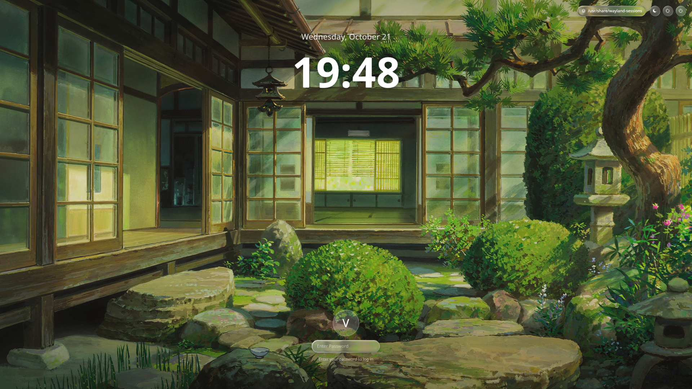

# MacTahoe-SDDM-Theme

<p align="center">
  
</p>

A near identical macOS 26 Tahoe-inspired SDDM greeter theme (Qt 6), which features true Liquid Glass refractions, and responsive vector glyphs, and more ported from Quickshell.

> [!IMPORTANT]
> This repository was heavily inspired by the following:
> `https://github.com/zayronxio/Sonoma-SDDMT`
> `https://github.com/0-ss/MacShell`

> [!NOTE]
> This project is very early in development. Expect changes, bugs, etc. 

---

## Features

- **Liquid Glass**: features shaders which calculate surface normal distortion and chromatic dispersion from live background.
- **Dynamic Backdrop Vignette**: apple-styled v depth gradients so typography & glass rims show well on practically any wallpapers.
- **Clock (SOON TO BE CUSTOMIZABLE)**: live mac-style oversized clock font with some subtle drop shadowing.
- **Password Pill**:
  - [x] enter squishing & shake animations on incorrect credentials
  - [x] features macOS dot physics with resizable scroll container for long passwords
  - [x] custom rounded cursor caret anchored to dots
  - [x] hover and active contour glow
  - [x] capslock indicator & spinner during verification
- **User & Session Switching**: clickable glass menus (for user accounts and session menu)
- **Power Options**: sleep, reboot, and poweroff icons in their own container pills.

---

## THEME REQUIREMENTS

- **SDDM** (with qt6 greeter support, e.g. `sddm-greeter-qt6`)
- `qt6-declarative` / `qt6-quick`
- `qt6-shadertools` (used for compiling shaders with `qsb`)

### Archlinux / endeavouros / manjaro / etc.
```bash
sudo pacman -S sddm qt6-declarative qt6-shadertools
```

### fedora / dnf
```bash
sudo dnf install sddm qt6-qtdeclarative-devel qt6-qtshadertools-devel
```

---

## INSTALLATION

### Automated installation

Clone & run the installer:

```bash
git clone https://github.com/hnpf/MacTahoe-SDDM-Theme.git
cd MacTahoe-SDDM-Theme
./install.sh
```

---

## live previewing theme

preview directly inside your desktop session w/o logging out

```bash
./install.sh --test
```

*(or, you can manually test with `sddm-greeter-qt6 --test-mode --theme /usr/share/sddm/themes/sddm-mac-tahoe`)*

---

## CUSTOMISATION

edit `/usr/share/sddm/themes/sddm-mac-tahoe/theme.conf`.

there is only one option for customization currently, that being `background`.

```bash
[General]
background=background.jpg # change to whatever, or replace.
```

change background.jpg to whatever you want, or replace the preexisting/default wallpaper.

---

## UNINSTALLING THE THEME

```bash
./install.sh --uninstall
```

---

## Credits

- design inspiration & shaders ported from: [MacLock / MacShell](https://github.com/0-ss/Macshell/)

- Base greeter from Zayronxio: [Sonoma-SDDMT](https://github.com/zayronxio/Sonoma-SDDMT/)
