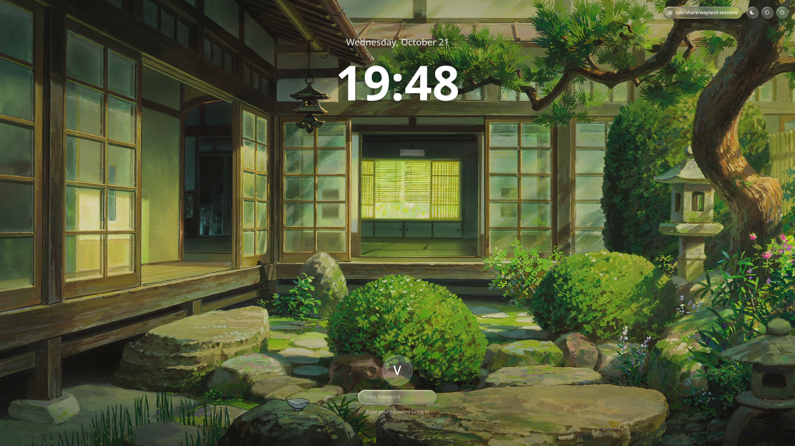

# MacTahoe-SDDM-Theme

<p align="center">
  
</p>

A near identical macOS 26 Tahoe-inspired SDDM greeter theme (Qt 6), which features true Liquid Glass refractions, and responsive vector glyphs, and more ported from Quickshell.

> [!IMPORTANT]
> This repository was heavily inspired by the following:
> `https://github.com/zayronxio/Sonoma-SDDMT`
> `https://github.com/0-ss/MacShell`

> [!NOTE]
> This project is very early in development. Expect changes, bugs, etc. 

---

## Features

- **Liquid Glass**: features shaders which calculate surface normal distortion and chromatic dispersion from live background.
- **Dynamic Backdrop Vignette**: apple-styled v depth gradients so typography & glass rims show well on practically any wallpapers.
- **Clock**: live mac-style clock with Shell27-compatible presets, font, weight, material, tint, date format, and 12/24-hour settings.
- **Password Pill**:
  - [x] enter squishing & shake animations on incorrect credentials
  - [x] features macOS dot physics with resizable scroll container for long passwords
  - [x] custom rounded cursor caret anchored to dots
  - [x] hover and active contour glow
  - [x] capslock indicator & spinner during verification
- **User & Session Switching**: clickable glass menus (for user accounts and session menu)
- **Power Options**: sleep, reboot, and poweroff icons in their own container pills.

---

## THEME REQUIREMENTS

- **SDDM** (with qt6 greeter support, e.g. `sddm-greeter-qt6`)
- `qt6-declarative` / `qt6-quick`
- `qt6-shadertools` (used for compiling shaders with `qsb`)

### Archlinux / endeavouros / manjaro / etc.
```bash
sudo pacman -S sddm qt6-declarative qt6-shadertools
```

### fedora / dnf
```bash
sudo dnf install sddm qt6-qtdeclarative-devel qt6-qtshadertools-devel
```

---

## INSTALLATION

### Automated installation

Clone & run the installer:

```bash
git clone https://github.com/hnpf/MacTahoe-SDDM-Theme.git
cd MacTahoe-SDDM-Theme
./install.sh
```

---

## live previewing theme

preview directly inside your desktop session w/o logging out

```bash
./install.sh --test
```

*(or, you can manually test with `sddm-greeter-qt6 --test-mode --theme /usr/share/sddm/themes/sddm-mac-tahoe`)*

---

## CUSTOMISATION

edit `/usr/share/sddm/themes/sddm-mac-tahoe/theme.conf`.

The theme reads `~/.config/macbar/settings.json` for the selected user when that file is readable by SDDM. It refreshes the clock settings while the greeter is open, and does not require Shell27 to be installed. If the file is in another location, set `macbarSettingsFile` to an absolute path; `%USER%` expands to the selected login name and `%HOME%` to `/home/<user>`.

SDDM must be able to traverse the user's home directory and read the JSON file. The installer enables Qt's `QML_XHR_ALLOW_FILE_READ=1` greeter environment flag for this; manual installations must add the same variable to SDDM's `GreeterEnvironment`. For a private home directory, point `macbarSettingsFile` at a readable shared copy. When no shared settings file is available, the theme uses its defaults. Standalone values can also be added to `theme.conf` using the same keys: `lockClockStyle`, `lockClockFont`, `lockClockWeight`, `lockClockMaterial`, `lockClockIntensity`, `lockClockTint`, `lockClockDate`, and `use24h`.

```bash
[General]
background=background.jpg # change to whatever, or replace.
macbarSettingsFile=/home/%USER%/.config/macbar/settings.json
```

change background.jpg to whatever you want, or replace the preexisting/default wallpaper.

---

## UNINSTALLING THE THEME

```bash
./install.sh --uninstall
```

---

## Credits

- design inspiration & shaders ported from: [MacLock / MacShell](https://github.com/0-ss/Macshell/)

- Base greeter from Zayronxio: [Sonoma-SDDMT](https://github.com/zayronxio/Sonoma-SDDMT/)
